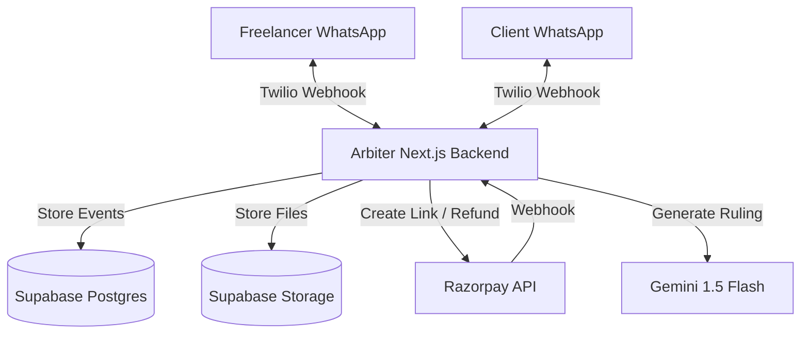
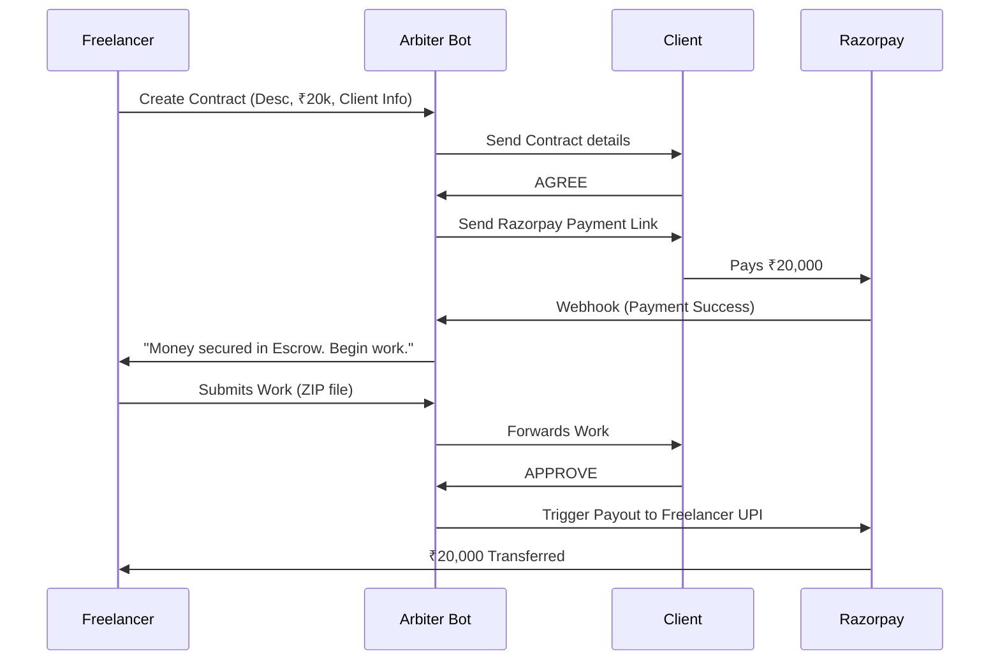
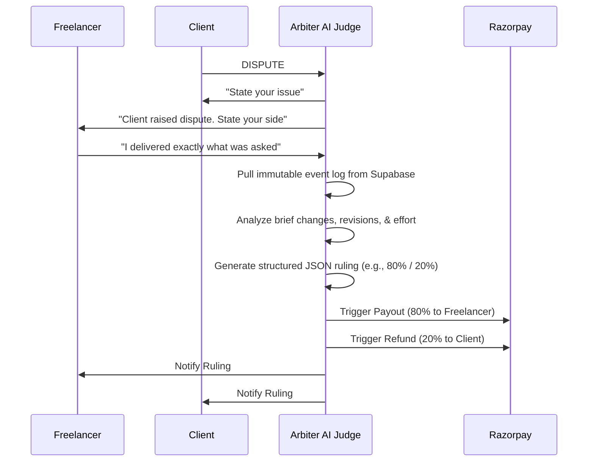

# ⚖️ Arbiter

**The WhatsApp-native, AI-powered escrow and dispute resolution system for India's gig economy.**

Built for the **Razorpay Buildathon (Track 05: Open Track)**.

---

## 🚨 The Problem

India has over 15M+ gig workers and freelancers. Currently, when a freelancer delivers work and the client ghosts them, they have **zero recourse**. 
* Existing escrow platforms are complex, require paperwork, and cost too much.
* Simple payment tools (Razorpay Links, UPI) offer no contract layer or dispute resolution.

## 💡 The Solution

**Arbiter** is the missing layer between agreement and payment. It lives entirely inside WhatsApp—no app downloads, no lawyer fees.

1. **Agree:** Freelancer and client agree on terms via a WhatsApp bot.
2. **Secure:** Client pays the agreed amount into a Razorpay Escrow via a secure link.
3. **Work:** Freelancer submits work (files, links) directly in the chat.
4. **Approve:** Client reviews. If approved, Razorpay Payouts instantly sends the money to the freelancer's UPI.
5. **Dispute:** If a disagreement happens, an **impartial AI Judge (Gemini 1.5 Flash)** reads the entire encrypted chat history (the evidence log) and automatically executes a fair split of the funds.

---

## 🏗️ Architecture

Arbiter acts as a secure relay between the freelancer and the client, intercepting and logging all events to ensure an immutable ground truth.



---

## 🔄 Core Workflows

### 1. Escrow & Approval Flow


### 2. Dispute Resolution Flow


---

## 🛡️ Protection Mechanisms

Arbiter is designed to protect **both** parties symmetrically:

- **No Auto-Release:** Submitting files never triggers auto-payment. Client must explicitly approve.
- **Sequential Lock:** Freelancers cannot spam files. They must wait for client feedback.
- **Revision Limits:** Enforced hard caps on revisions based on the initial contract.
- **Inactivity Timeout:** If a client ghosts for 96 hours, the contract auto-escalates to a dispute.
- **Scope Creep Detection:** The AI judge heavily penalizes clients who introduce new requirements not present in the original ground-truth contract.

---

## 🛠️ Tech Stack

- **Framework:** Next.js (App Router) with TypeScript
- **Database & Storage:** Supabase (Postgres & S3-compatible storage)
- **WhatsApp Integration:** Twilio WhatsApp Sandbox
- **Payments:** Razorpay Payment Links (Escrow In), Payouts (Escrow Out), Refunds
- **AI Arbitrator:** Google Gemini 1.5 Flash (via `@google/genai`)
- **Hosting:** Vercel

---

## 🚀 Setup & Local Development

1. **Clone the repository:**
   ```bash
   git clone https://github.com/yourusername/arbiter.git
   cd arbiter
   npm install
   ```

2. **Database Setup:**
   - Create a Supabase project.
   - Run the SQL script found in `database_schema.sql` in the Supabase SQL editor.

3. **Environment Variables:**
   Create a `.env.local` file:
   ```env
   NEXT_PUBLIC_SUPABASE_URL=your_supabase_url
   SUPABASE_SERVICE_ROLE_KEY=your_supabase_service_key
   TWILIO_ACCOUNT_SID=your_twilio_sid
   TWILIO_AUTH_TOKEN=your_twilio_token
   RAZORPAY_KEY_ID=your_razorpay_key
   RAZORPAY_KEY_SECRET=your_razorpay_secret
   GEMINI_API_KEY=your_gemini_key
   ```

4. **Run the dev server:**
   ```bash
   npm run dev
   ```

5. **Expose Webhook (ngrok):**
   ```bash
   ngrok http 3000
   ```
   *Paste your ngrok URL (`https://<your-url>.ngrok.io/api/whatsapp-webhook`) into Twilio's Sandbox Configuration.*
