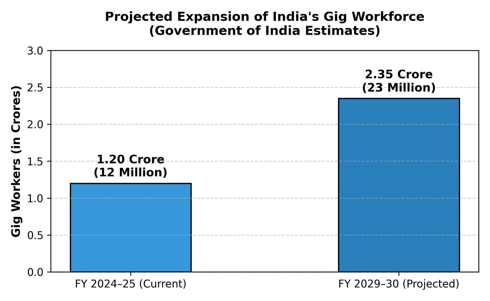
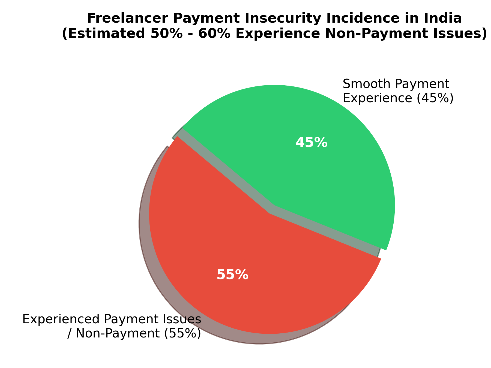
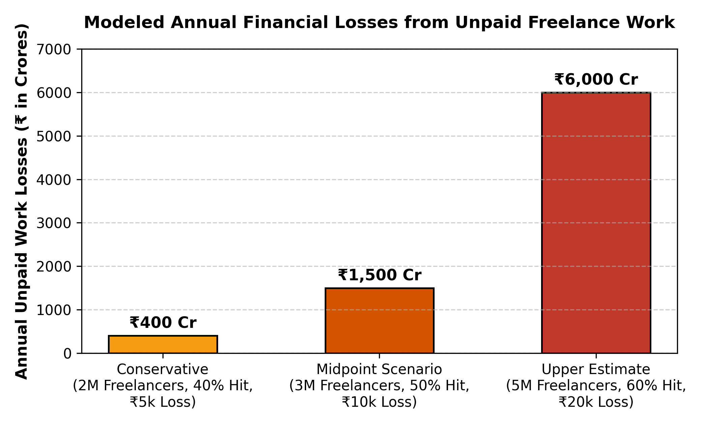
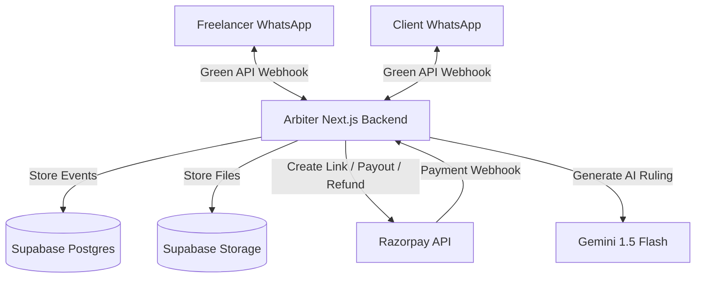
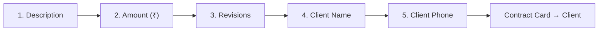
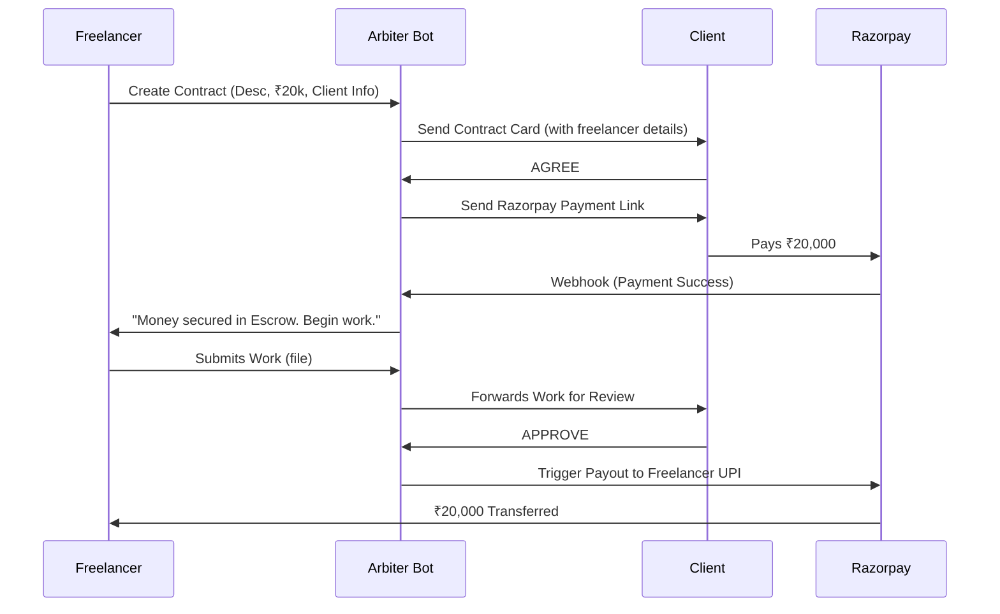
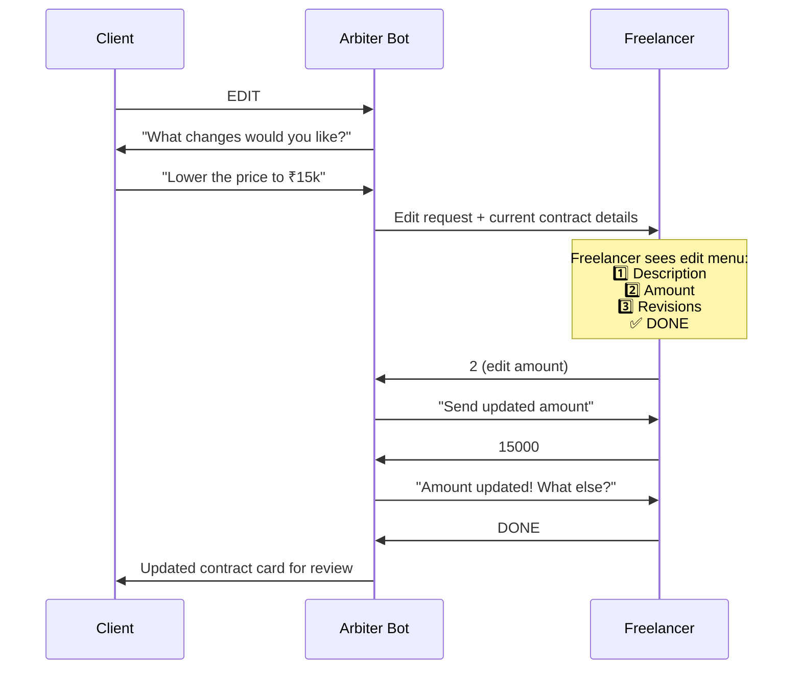
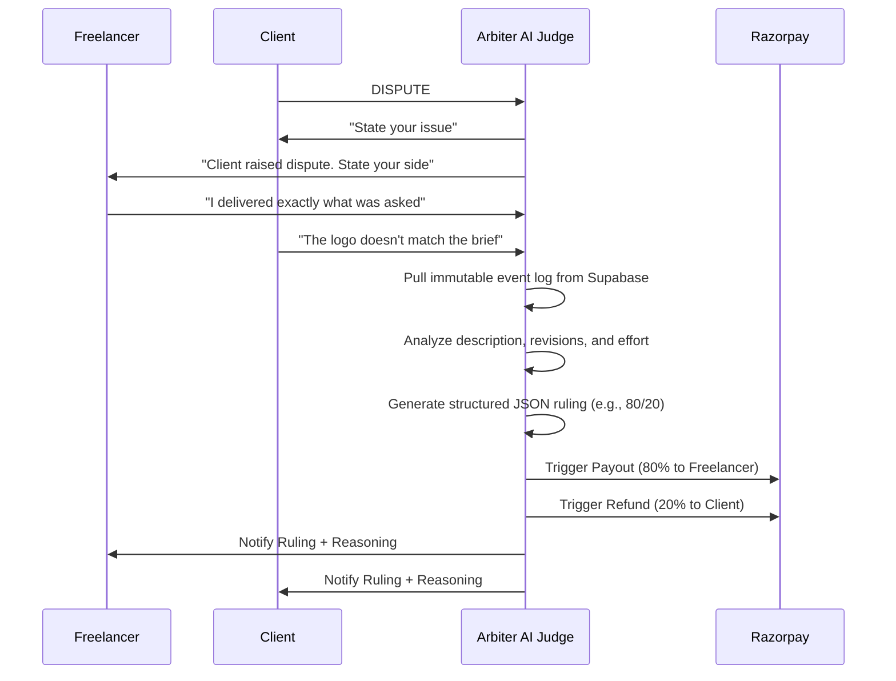
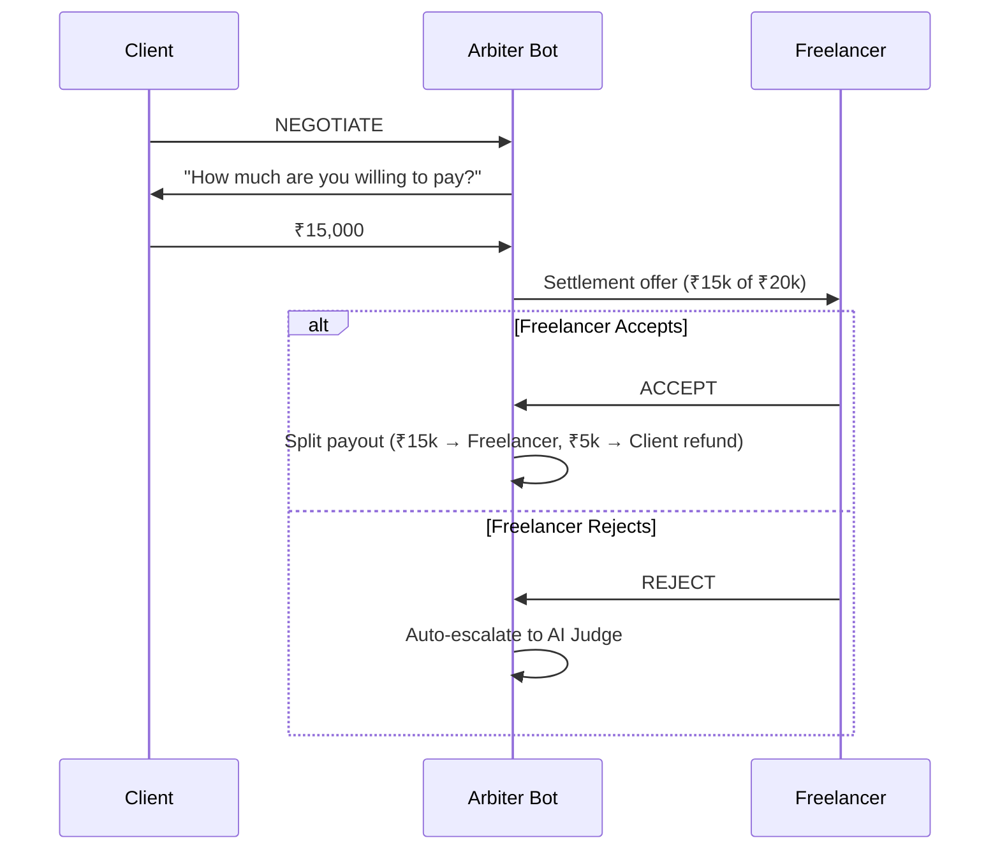
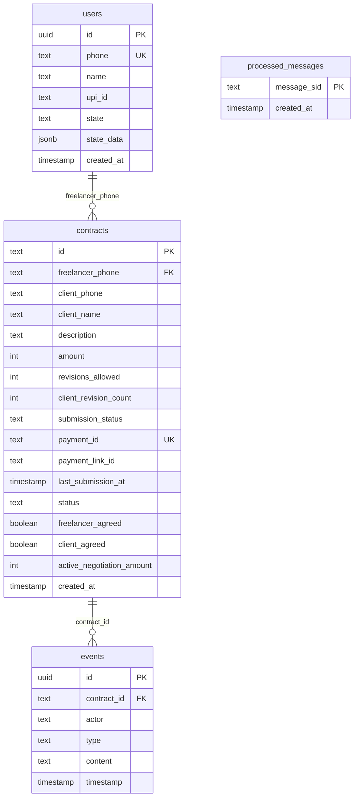

# ⚖️ Arbiter

**The WhatsApp-native, AI-powered escrow and dispute resolution system for India's gig economy.**

> 🌐 **Live Demo:** [arbiter-omega.vercel.app](https://arbiter-omega.vercel.app)
> 💬 **Try it:** Send `#arbiter` to [+91 9871852159 on WhatsApp](https://wa.me/919871852159?text=%23arbiter)

---

## 🚨 Background & Market Context

### Freelancer Payment Insecurity in India: Market Size & Financial Impact

India's gig economy is rapidly expanding, with approximately **1.2 crore gig workers in FY2024–25**, projected to reach **2.35 crore by FY2029–30**, according to government estimates. However, within this ecosystem, independent digital freelancers—including graphic designers, logo designers, web developers, app developers, video editors, content writers, and UI/UX designers—face a major financial risk: clients failing to pay for completed work.

<p align="center">
  
</p>

* **50%–60% Incident Rate:** Various surveys have indicated that approximately **50–60% of freelancers have experienced payment-related issues or non-payment at least once**, although these figures vary by population and methodology. India currently lacks a reliable nationwide dataset measuring the total value of freelance work permanently unpaid.

<p align="center">
  
</p>

* **Economic Impact:** For an illustrative market estimate, India's digital/project-based freelance workforce can be assumed to be approximately **2–5 million individuals**. Assuming 40–60% experience payment problems and affected freelancers permanently lose an average of ₹5,000–₹20,000 annually, the estimated financial losses range from **₹400 crore to ₹6,000 crore per year**.
* **Midpoint Scenario:** A baseline scenario of 3 million freelancers, a 50% incidence rate, and a ₹10,000 average annual loss suggests approximately **₹1,500 crore in annual losses**.

| Scenario | Freelancer Population | Incidence Rate | Avg Annual Loss | Estimated Annual Economic Loss |
| :--- | :--- | :--- | :--- | :--- |
| **Conservative** | 2.0 Million (20 Lakh) | 40% (800,000) | ₹5,000 / freelancer | **₹400 Crore** |
| **Midpoint Baseline** | 3.0 Million (30 Lakh) | 50% (1,500,000) | ₹10,000 / freelancer | **₹1,500 Crore** |
| **Upper Risk** | 5.0 Million (50 Lakh) | 60% (3,000,000) | ₹20,000 / freelancer | **₹6,000 Crore** |

<p align="center">
  
</p>

> **Key Takeaway:** India's freelance ecosystem is growing rapidly, but payment insecurity remains a massive hurdle. Even under conservative assumptions, unpaid freelance work accounts for hundreds to thousands of crores in potential annual economic losses. Existing commercial escrow services levy 10%–20% cuts with foreign currency barriers, while standard payment links offer zero milestone dispute protection.

---

## 💡 The Solution

**Arbiter** is the missing layer between agreement and payment. It lives entirely inside WhatsApp — no app downloads, no lawyer fees.

1. **Agree:** Freelancer and client agree on terms via a WhatsApp bot.
2. **Secure:** Client pays the agreed amount into a Razorpay Escrow via a secure link.
3. **Work:** Freelancer submits work (files, links) directly in the chat.
4. **Approve:** Client reviews. If approved, Razorpay Payouts instantly sends the money to the freelancer's UPI.
5. **Dispute:** If a disagreement happens, an **impartial AI Judge (Gemini 1.5 Flash)** reads the entire event log and automatically executes a fair split of the funds.

---

## 🏗️ Architecture

Arbiter acts as a secure relay between the freelancer and the client, intercepting and logging all events to ensure an immutable ground truth.



---

## 🔄 Core Workflows

### 1. Contract Creation Flow (5 Steps)

The freelancer creates a contract through a guided 5-step wizard:



The contract card sent to the client includes:
- Work description, amount, and revision count
- **Freelancer name and phone number**
- **Client name**
- Options: **AGREE** (pay escrow) or **EDIT** (request changes)

### 2. Escrow & Approval Flow



### 3. In-Place Contract Editing Flow

When a client requests edits to a pending contract, the freelancer gets an **in-place editing wizard** — no need to create a new contract:



### 4. Dispute Resolution Flow



### 5. Settlement / Negotiation Flow



---

## 🛡️ Protection Mechanisms

Arbiter is designed to protect **both** parties symmetrically:

| Feature | Description |
|---|---|
| **#arbiter Trigger** | Bot only responds to messages containing `#arbiter` or from users in an active flow. Personal chats are never touched. |
| **No Auto-Release** | Submitting files never triggers auto-payment. Client must explicitly APPROVE. |
| **Sequential Lock** | Freelancers cannot spam files. They must wait for client review before resubmitting. |
| **Revision Limits** | Enforced hard caps based on the initial contract terms. |
| **Rapid Submission Warning** | If a freelancer resubmits within 10 minutes, the client sees a warning banner. |
| **In-Place Editing** | Contracts are edited, not recreated — keeping history clean and reducing confusion. |
| **Auto-Registration** | Clients receiving a contract are automatically registered so AGREE works immediately. |
| **Scope Creep Detection** | The AI judge penalizes clients who introduce requirements not in the original contract. |
| **Idempotency** | Duplicate webhook deliveries are detected and ignored via message ID tracking. |

---

## 🛠️ Tech Stack

| Layer | Technology |
|---|---|
| **Framework** | Next.js 16 (App Router) + TypeScript |
| **Database & Storage** | Supabase (Postgres + S3-compatible storage) |
| **WhatsApp Integration** | Green API (QR-code linked personal number) |
| **Payments** | Razorpay Payment Links (Escrow In), Payouts (Escrow Out), Refunds |
| **AI Arbitrator** | Google Gemini 1.5 Flash (via `@google/genai`) |
| **Hosting** | Vercel (auto-deploy from GitHub) |

---

## 📁 Project Structure

```
arbiter/
├── src/
│   ├── app/
│   │   ├── page.tsx                          # Landing page
│   │   ├── layout.tsx                        # Root layout
│   │   └── api/
│   │       ├── whatsapp-webhook/route.ts     # Main bot logic (state machine)
│   │       └── razorpay-webhook/route.ts     # Payment confirmation handler
│   └── lib/
│       ├── greenApi.ts                       # Green API WhatsApp client
│       ├── supabase.ts                       # Supabase client
│       ├── razorpay.ts                       # Razorpay client
│       ├── judge.ts                          # Gemini AI dispute adjudicator
│       └── storage.ts                        # File upload helpers
├── public/
│   └── Arbiter-logo.png                      # Brand logo
├── database_schema.sql                       # Full DB schema (run in Supabase SQL Editor)
├── .env.local                                # Environment variables (not committed)
└── package.json
```

---

## 🗄️ Database Schema



---

## 🚀 Setup & Local Development

### 1. Clone the repository
```bash
git clone https://github.com/its-ashutosh-pathak/Arbiter.git
cd Arbiter
npm install
```

### 2. Database Setup
- Create a [Supabase](https://supabase.com) project.
- Run the SQL script in `database_schema.sql` in the Supabase SQL Editor.

### 3. Green API Setup (WhatsApp)
- Create a free account at [green-api.com](https://green-api.com).
- Create an instance (Developer tariff — free forever).
- Scan the QR code with your WhatsApp (Linked Devices).
- Copy your `idInstance` and `apiTokenInstance`.
- Set the webhook URL to: `https://your-domain.com/api/whatsapp-webhook`
- Enable `incomingWebhook: yes` in instance settings.

### 4. Environment Variables
Create a `.env.local` file:
```env
# Supabase
NEXT_PUBLIC_SUPABASE_URL=https://your-project.supabase.co
SUPABASE_SERVICE_ROLE_KEY=your_service_role_key

# Green API (WhatsApp)
GREEN_API_ID_INSTANCE=your_instance_id
GREEN_API_TOKEN_INSTANCE=your_api_token

# Razorpay
RAZORPAY_KEY_ID=your_razorpay_key
RAZORPAY_KEY_SECRET=your_razorpay_secret
RAZORPAY_ACCOUNT_NUMBER=your_razorpayx_account_number
RAZORPAY_WEBHOOK_SECRET=your_webhook_secret

# Gemini AI
GEMINI_API_KEY=your_gemini_api_key

# App URL
NEXT_PUBLIC_APP_URL=https://your-domain.com/
```

### 5. Run the dev server
```bash
npm run dev
```

### 6. Deploy to Vercel
```bash
vercel --prod
```
Add all environment variables in Vercel Dashboard → Settings → Environment Variables.

---

## 💬 Bot Commands

| Command | Who | What it does |
|---|---|---|
| `#arbiter` | Anyone | Activate the bot / Open main menu |
| `1` | Freelancer | Create a new contract |
| `2` | Anyone | View active contracts |
| `3` | Anyone | How it works |
| `AGREE` | Client | Accept a pending contract and pay |
| `EDIT` | Client | Request changes to a pending contract |
| `APPROVE` | Client | Release escrow payment to freelancer |
| `REVISION` | Client | Request work changes (uses revision count) |
| `NEGOTIATE` | Client | Propose a partial settlement |
| `DISPUTE` | Either | Escalate to AI Judge |
| `ACCEPT` | Freelancer | Accept a settlement offer |
| `REJECT` | Freelancer | Reject settlement → AI Judge |
| `EDIT UPI` | Anyone | Update your UPI ID |
| `RESET` | Anyone | Reset session to main menu |

---

## 📄 License

MIT
